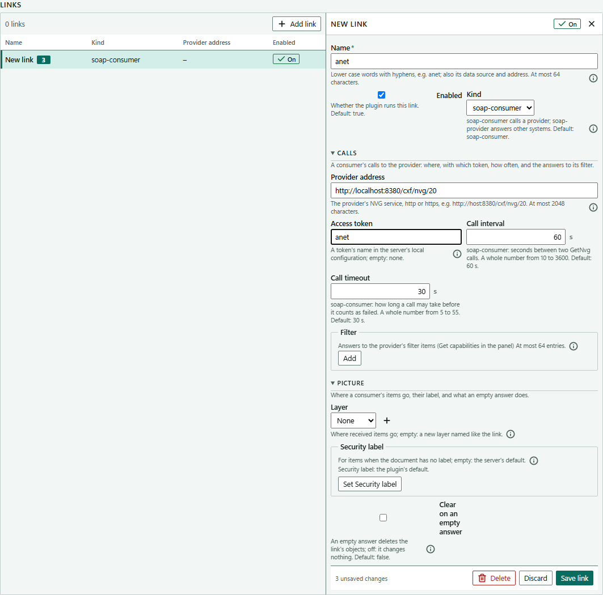
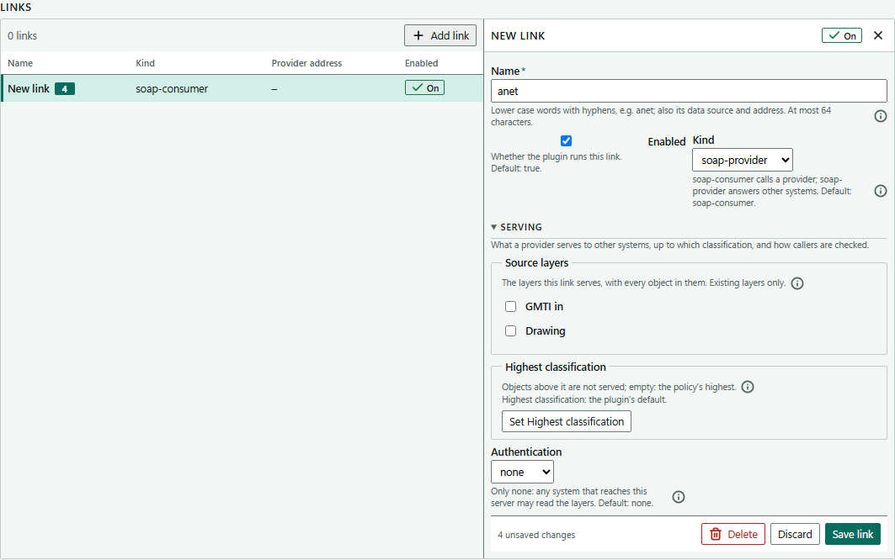
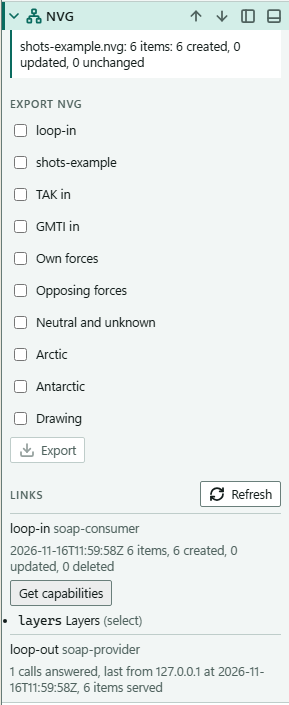

# NVG

The NVG plugin reads and writes NVG, the NATO Vector Graphics format. What users do with files is described in [NVG: import and export](03-18-nvg.md). This page is about the **links**: NVG web services, which let emcc read another system's NVG picture, and let other systems read a picture from emcc.

The plugin does nothing over a network until you add a link. Files need no link. The category is called **NVG**, under the heading Data Links.



## Links

Add a link with **Add link**: the links are a table with a form beside it (see [Lists of links](05-00-settings.md)). The form shows only the fields that the link's **Kind** uses. A link that reads has the groups Calls and Picture.

| Setting | What it does |
|---|---|
| Name | The link's name: lowercase words separated by hyphens, at most 64 characters, for example `anet`. It is the data source of what the link receives, its entry in the Monitor and, for a link that offers, the last part of its address. `manual` and `nvg-file` cannot be used: the form refuses them when you save. The field starts empty |
| Enabled | Whether the plugin runs this link. Default: yes |
| Kind | **soap-consumer** reads another system's NVG web service. **soap-provider** offers a layer as an NVG web service. Default: soap-consumer |

### A link that reads (soap-consumer)

The plugin calls the other system's NVG web service every so often (`GetNvg`) and keeps a layer equal to the answer.

| Setting | What it does |
|---|---|
| Provider address | The address of the other system's NVG web service, starting with `http://` or `https://`, for example `http://localhost:8380/cxf/nvg/20`. It may be on another network or on the internet. Only an administrator sets it |
| Access token | The **name** of an access token that is kept in the server's own configuration, not in the settings. The plugin sends the token as `Authorization: Bearer`. Empty: no token. See "The access token" below |
| Call interval | The time between two calls, from 10 to 3 600. Default 60 |
| Call timeout | How long a call may take before it counts as failed, from 5 to 55. Default 30 |
| Filter | The answers to the provider's filter questions that are sent with each call. Each entry (add one with **Add**; a saved entry is folded, and its arrow opens it) has a **Filter item** (the id of one of the provider's filter items) and a **Value**, for example `pastDays` and `1`. Use **Get capabilities** in the [NVG panel](03-18-nvg.md) to see the ids. Empty: no filter |
| Layer | Where the items go: a layer in the list, or a new layer that you make with the **+** button. Empty: a new layer named like the link |
| Security label | The security label of the layer and of items that have none in the document. It is only in force when you click **Set Security label**. Default: the server's default label |
| Clear on an empty answer | Whether an answer without items deletes the link's objects. Off by default, so that a bad answer cannot empty the layer |

**What the link does with an answer.** Each answer is the whole picture. Each item is made, or updated if it is already there. An object of the link whose item is no longer in the answer is **deleted**, but only after a complete answer that the plugin could read. A failed call, an error from the other system, a timeout or an answer that is refused changes nothing, and is counted. A call that is still running when the next is due makes the next one skip its turn, and the skip is counted. A changed setting applies at the next call, without a restart.

### A link that offers (soap-provider)

The plugin answers other systems' `GetCapabilities` and `GetNvg` calls with the objects of the layers you choose.



| Setting | What it does |
|---|---|
| Source layers | The layers that the link offers, ticked in a list. Existing layers only. Every object in them is written out |
| Highest classification | Objects above it are not offered. Empty: the highest classification of the server's default policy |
| Authentication | **none**. This is the only choice in this release, see below |

The address of the offered service is `/api/services/nvg/nvg/<name>` on this server, for example `http://emcc-host:8080/api/services/nvg/nvg/loop-out`. It takes SOAP calls (`text/xml`, and a SOAP 1.2 call is answered in SOAP 1.2). A call that is not `GetCapabilities` or `GetNvg` gets a SOAP fault. An unknown or disabled link answers "not found". `GetCapabilities` offers one filter, **layers**, with the names of the source layers. `GetNvg` with that answer gives those layers, and without it all of them. An object that is no longer in the layer is no longer in the next answer. An object that came into emcc through a link is never given back to that link.

> **There is no login on an offered service.** In this release a link that offers answers every system that can reach this server, also in the no-login mode. Turning it on makes its source layers readable by any such system. Use it only on a network you trust, and keep the server on that network: by default the server listens on this computer only. See [Running emcc](01-02-running.md).

### The access token

A token is a secret, so it is never written in the settings. Put it in a file of its own in `settings/credentials/`, called `http-<name>.properties` (the release has the template `http-example.properties`; see [The settings files](08-01-settings-files.md)), for example `http-anet.properties`:

```
emc2.http.credentials.anet.token=<the token>
```

and write `anet` in the link's **Access token**. The name is the part between `credentials.` and `.token`. Restart the server after changing the file, and keep the folder readable only by the account that runs emcc and by administrators.

## Trying it on one emcc

You can let emcc read its own layer through the two kinds of link:

1. Make a layer with some objects, for example by [importing an NVG file](03-18-nvg.md).
2. Add a link with the name `loop-out`, the kind **soap-provider**, and tick the layer under **Source layers**.
3. Add a link with the name `loop-in`, the kind **soap-consumer**, and the Provider address `http://127.0.0.1:<port>/api/services/nvg/nvg/loop-out` (use the port of the server). Set **Call interval** to 10. Leave **Layer** empty, so that a new layer named `loop-in` is made.
4. Click **Save link** for each of the two links. In the NVG panel, click **Refresh** in Links. The first call can come before the offering link has read its layer, and then it says "0 items". The next call, 10 seconds later, brings the objects into the new layer.



## Other settings

| Setting | What it does | Default |
|---|---|---|
| Largest document | The largest NVG document that the plugin reads or writes, in MiB: files that users import, answers that a link reads, and answers that a link offers. From 1 to 16 | 16 |

This setting is above the table of links and is saved with **Save** at the foot of the page.

## Limits and safety

The plugin reads XML with the limits of the NVG panel: no document type declaration, at most 16 MB, 64 levels, 100 000 items and 1 000 000 points. A link that reads makes calls only to the address in its Url, never to an address that came in a document or a request. The plugin has no permission of its own: Import and Export use the user's permissions in the workspace, and the settings need the permission to administer settings. See [NVG: import and export](03-18-nvg.md) for what is not read.

The [Monitor](06-00-monitor.md) shows each link: for a link that reads, the last call and its counts and the next call; for a link that offers, the calls answered, the last caller and the items served.
