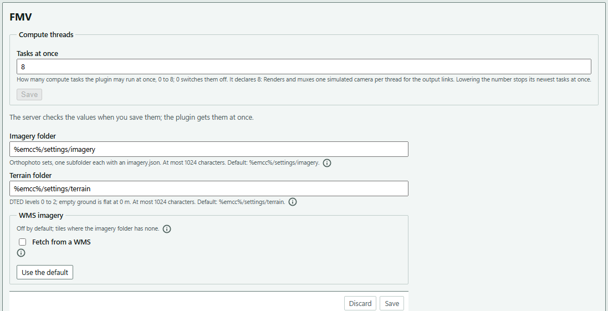
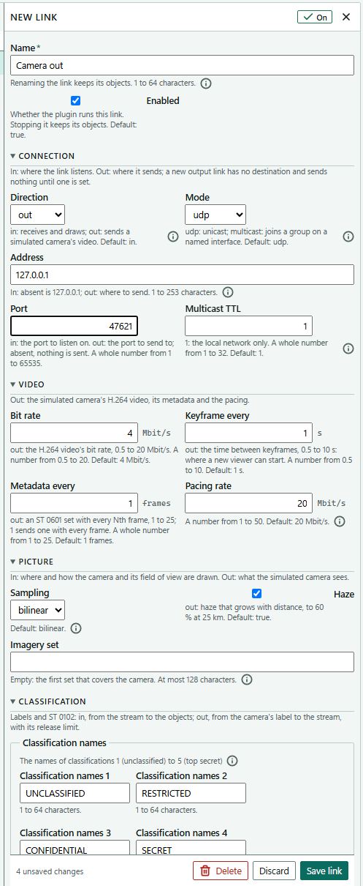
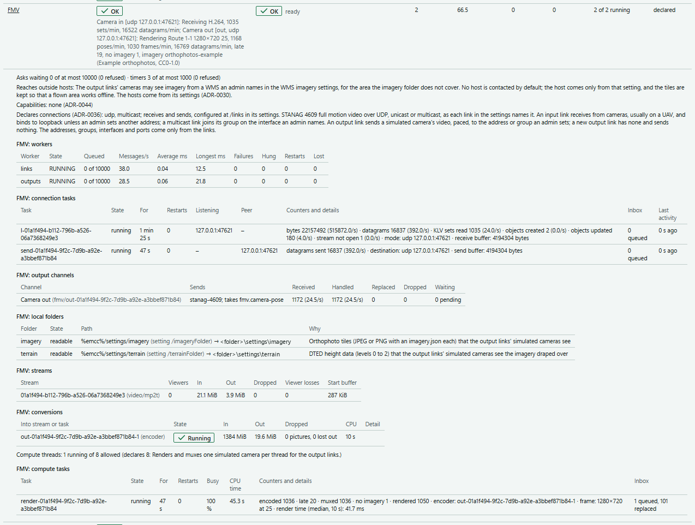

# FMV output links, imagery and terrain

This chapter is for the administrator. For the whole job in order, see the guide [Setting up the UAV simulation](07-02-uav-simulation.md). It sets up what a [simulated camera](04-06-camera.md) needs: an **output link** that sends the video, the **imagery** and the **height data** that the picture is drawn from, and, if you want it, a **WMS** that fills in the imagery where you have none. The settings are in the category **FMV** of Settings. The links that **receive** video are in [FMV: full motion video](03-19-fmv.md); the same table holds both.

## What you need

| You need | What happens without it |
|---|---|
| An output link with an address and a port | The link sends nothing, and says *No destination* |
| An imagery set (photographs) that covers where the camera looks | The ground is plain grey |
| Height data (DTED) that covers it | The ground is flat at sea level |
| The converter `tools/ffmpeg/ffmpeg.exe` of the release | The camera says *No encoder installed*. Only Windows has the encoder that emcc uses |
| An input link on the same address and port, if emcc is to show the video | The video is sent, and emcc does not show it |

emcc comes with none of the images. The release has the two folders, `settings/imagery` and `settings/terrain`, both empty but for a short readme, and the cameras read them by themselves. You bring both, your own photographs and your own height data. See below.



## An output link

A link is one entry in the table of links. Click **Add link**, choose **Direction: out**, and fill in the form. A link with the direction **in** receives video; the direction **out** sends the video of a simulated camera. The form shows only the fields of the direction you choose. **One output link sends the video of one camera at a time**: the first camera whose poses arrive holds the link until two seconds after its last pose. Poses of another camera meanwhile are dropped.



### Connection

| Field | What it does | Default |
|---|---|---|
| Name | The name of the link. It is what a camera's **Output** list shows. Renaming the link keeps its identity | Required |
| Enabled | Whether the plugin runs the link. A disabled link offers no output, and a camera that uses it says *Output missing* | On |
| Mode | **udp** sends to one address. **multicast** sends to a group, from the network interface that you name | udp |
| Address, Port | For udp: the address and the port that the video is sent to. **A new link has neither, and sends nothing** until you set them. Any computer may be the address, for example a receiver on the network. To see the video in emcc on the same computer, use `127.0.0.1` | None |
| Group, Interface, Port, Multicast TTL | For multicast: the group (224.0.0.0 to 239.255.255.255), the interface by its name or address (required), the port, and how many routers the datagrams may cross, 1 to 32. 1 keeps them on the local network | TTL 1 |

The address comes only from this setting, never from a camera or a message. It is one of the connections that the plugin declares, and the [Monitor](06-00-monitor.md) shows it. A receiver at the address gets the video as STANAG 4609 in UDP datagrams of seven transport stream packets. The pacing keeps a burst from being sent all at once.

### Video

| Field | What it does | Default | Limit |
|---|---|---|---|
| Bit rate | The H.264 video's bit rate | 4 Mbit/s | 0.5 to 20 |
| Keyframe every | The time between keyframes, where a receiver that joins can start | 1 s | 0.5 to 10 |
| Metadata every | An ST 0601 set of metadata with every Nth frame. 1 sends one with every frame | 1 | 1 to 25 |
| Pacing rate | The most that the link sends. The datagrams are paced to it so that a keyframe does not leave as one burst that a receiver drops | 20 Mbit/s | 1 to 50 |

### Picture

| Field | What it does | Default |
|---|---|---|
| Sampling | **bilinear** is smoother, **nearest** is faster | bilinear |
| Haze | Haze that grows with the distance, to 60 % at 25 km | On |
| Imagery set | The name of the imagery set that the camera sees: a subfolder of the imagery folder. Empty: the first set, in the order of the folder names, that covers the camera | Empty |

### Classification

| Field | What it does | Default |
|---|---|---|
| Classification names | The names of the classifications 1 (unclassified) to 5 (top secret) in the video's security metadata (ST 0102). A track's label is turned into a number by its place in this list. | NATO's: UNCLASSIFIED, RESTRICTED, CONFIDENTIAL, SECRET, COSMIC TOP SECRET |
| Highest classification | A camera whose track's label is above it is **not drawn and not sent**, and is counted. This is the release limit of the link | The classification of the server's default label |
| Classifying country | The country that classifies the video, for ST 0102: `//` and one to four letters | `//NATO` |

A change to a link starts the picture of its camera again, and the video has a short gap.

## Imagery

The pictures are drawn from **orthophotos**: aerial photographs with known corners. They are kept in the **imagery folder**, `settings/imagery` by default. The setting **Imagery folder**, at the top of the FMV page, can name another folder; it is read only, and nothing outside it is read. The release has the folder, empty but for a short `readme.txt`: you put one subfolder in it for each set.

One **imagery set** is one subfolder with the photographs as tiles and a file, `imagery.json`, that says where each tile is:

```
settings/imagery/orthophotos-example/imagery.json
settings/imagery/orthophotos-example/tile_0_0.jpg
settings/imagery/orthophotos-example/tile_0_1.jpg
```

```
{
  "name": "orthophotos-example",
  "source": "Example orthophotos",
  "licence": "CC0-1.0",
  "crs": "EPSG:3006",
  "tiles": [
    { "file": "tile_0_0.jpg", "min": [616760.25, 6919844.80], "max": [619260.25, 6922344.80], "width": 2500, "height": 2500 },
    { "file": "tile_0_1.jpg", "min": [619260.25, 6919844.80], "max": [621760.25, 6922344.80], "width": 2500, "height": 2500 }
  ]
}
```

| Key | What it is |
|---|---|
| `name` | The name of the set |
| `source`, `licence` | **Both are required.** Who made the photographs and on what terms. A set without them is refused. The video carries the photographs onward, so their terms decide where the video may go. The Monitor shows both |
| `crs` | The coordinate system of the corners: `EPSG:3006` (SWEREF 99 TM, in metres: easting and northing) or `EPSG:4326` (WGS84: longitude and latitude, in degrees, **longitude first**) |
| `tiles` | One entry for each tile. `file` is a JPEG or PNG file in the set's folder. `min` and `max` are the **outer corners** of the tile, lower left and upper right, `[x, y]` in the coordinate system. `width` and `height` are the picture's size in pixels. A tile whose picture has another size is refused |

The two tiles above lie side by side: the second begins where the first ends. A set may have any number of tiles, large or small. The server reads the tiles that lie near a camera, nearest first, and keeps at most about 256 million pixels of them for each link. The rest is grey.

Where do the photographs come from? From wherever you have the right to use them: your own flights, or the open orthophotos that some national mapping agencies publish. How a set is made from a source, that is, how the corners are worked out, is outside this manual. emcc reads only the tiles and the file.

A set that is refused does not stop the plugin. The Monitor and the log name it and say why, for example *the imagery set orthophotos-example is refused: licence is required*, and the picture is grey until you correct the file and start the camera again.

## Terrain

The heights are **DTED** files, levels 0, 1 and 2, in the **terrain folder**: `settings/terrain` by default, which is the folder that the [Terrain](05-20-terrain.md) panel reads too. The setting **Terrain folder** can name another. The files have the paths `e<longitude>/n<latitude>.dt<level>`, for example `e017/n62.dt2`, and the highest level of a cell is used.

You supply the DTED files and put them into that folder; [Terrain](05-20-terrain.md) says how. Without height data the ground is flat at sea level, and a camera over hills sees them flat.

## WMS imagery

A WMS can fill in where the imagery folder has no photograph. It is **off by default**. When you turn it on, a camera fetches the tiles it lacks from the server that you name, as it needs them, and **keeps** them, so that an area that a camera has flown can be seen again without the network.

| Field | What it does | Default |
|---|---|---|
| Fetch from a WMS | On: the cameras fetch the tiles the imagery folder lacks. Off: no request is made, and tiles that are kept are still used | Off |
| Server | The address of the WMS, `http` or `https`, without the request's parameters and without a user name. It is the only place that names the host | None |
| Layer | The name of the WMS layer, as its capabilities list it | None |
| CRS | `EPSG:3006` or `EPSG:4326`. The server must offer it for the layer | EPSG:3006 |
| Format | `image/jpeg` is smaller, `image/png` has no loss | image/jpeg |
| Tile size | 256 or 512 pixels | 256 |
| Ground resolution | Metres on the ground to a pixel, 0.25 to 10 | 1 |
| Source, Licence | **Both are required** before anything is fetched. They are shown in the Monitor and kept with each tile | None |
| Access token | The **name** of an access token in the server's credentials, sent as `Authorization: Bearer`. Empty: none. The token itself is never in a setting. See [The settings files](08-01-settings-files.md) | Empty |

How it works:

- **Which tiles.** The tiles within two kilometres of where the camera looks, nearest first. If the camera moves, the choice is made again when that point has moved 500 metres. A tile that the imagery folder covers is not fetched.
- **How.** WMS version 1.3.0 only. With `EPSG:4326` the request has the latitude first; with `EPSG:3006`, the northing first. At most 4 requests at a time and 20 a second, each with a time limit and at most 512 KiB.
- **The cache.** At most 900 tiles are kept, in emcc's own data, and the one that was used least recently is removed first. The cache survives a restart and a change of the settings. A tile is looked up in the cache before it is fetched. A tile from another server, layer or format is used and fetched again when the server answers. A tile of another tile size is never used.
- **No network.** Where the server cannot be reached, the camera uses the tiles that are kept. The Monitor counts the failures, and the last one is shown.
- **The terms.** The video carries the imagery onward, so the terms of the WMS decide where the video may go.

Only the server of emcc reaches the WMS, and the host in **Server** is the only one that it contacts. The browsers never do.

## Compute threads and the encoder

Each camera that sends takes one **compute thread** of the FMV plugin, where the pictures are drawn, and one **conversion slot** of the server, where the video is encoded. The plugin declares **8** compute threads. At the top of the FMV page the group **Compute threads** has the field **Tasks at once**, from 0 to 8: lower it to let fewer cameras draw at once, or put 0 to switch drawing off. The slots are `emc2.conversions.max`, which the conversions of MPEG-2 streams share. See [Compute threads](08-06-compute-threads.md) and [What you may bring yourself](08-03-infrastructure.md).

A camera that cannot get a thread is *No render thread*, and tries again every ten seconds. A camera that cannot get a slot says *Waiting for a conversion slot*. A server without the converter says *No encoder installed*, and the link does not try again until you change the link or restart the server. If the encoder fails in another way, the link starts a new one after a minute and says *Encoder failed, started again after 60 s*.

## The Monitor

The [Monitor workspace](06-00-monitor.md) shows the output link in the part for FMV:



- **The line for the link**, in the list of plugins, says what the link does now: *No destination*, *Waiting for a pose*, *Rendering Route 1-1 1280×720 25*, *Above release limit*, *No render thread*, *Waiting for a conversion slot*, *No encoder installed*, *Encoder failed, started again after 60 s* or *Disabled*. It counts, for the last minute, the poses, the frames and the datagrams, and the things that went wrong: late poses, no imagery and so on. It names the imagery set in use, with its source and licence. A second line is for the WMS: where it fetches from, or that it does not, the tiles kept, fetched, taken from the cache, failed and waiting, and the last failure.
- **Output channels.** The link's output with what it takes, `fmv.camera-pose`, and how many poses it received and handled.
- **Local folders.** The imagery folder and the terrain folder, with their paths and whether they are readable.
- **Conversions.** The encoder of the link, its state and how much it has taken in and put out.
- **Compute threads.** The compute task of the link, for example `render-<id>`, with its busy share and, as a detail, the **render time**: the median of the last ten seconds. A render time above the time between two frames means that the camera cannot keep up.

## When something is wrong

| What you see | Why, and what to do |
|---|---|
| The link says *No destination* | It has no address and port, or no group, interface and port. Fill them in |
| The camera's picture is grey and the Monitor counts *no imagery* | No set covers where the camera looks. Check the corners in `imagery.json`, and that the folder is the one in **Imagery folder** |
| The log says an imagery set is refused | The message says why: no `source`, no `licence`, a tile of the wrong size or a file that is not a picture. Correct the file, and stop and start the camera |
| The ground is flat | No DTED cell covers the camera. Put the cell in the terrain folder |
| The WMS says *not fetching* and names a reason | Source or Licence is empty, the server's address is not valid, or Fetch from a WMS is off |
| The WMS counts failures | The server cannot be reached, or does not know the layer or the CRS. The kept tiles are used meanwhile |
| The input link in the Monitor says *Address already in use* | Another program on the computer has the port. Choose another port for both links |
| The camera never reaches 25 frames a second | The render time is above 40 milliseconds. Use a lower frame rate or frame size, nearest sampling, or fewer cameras |
