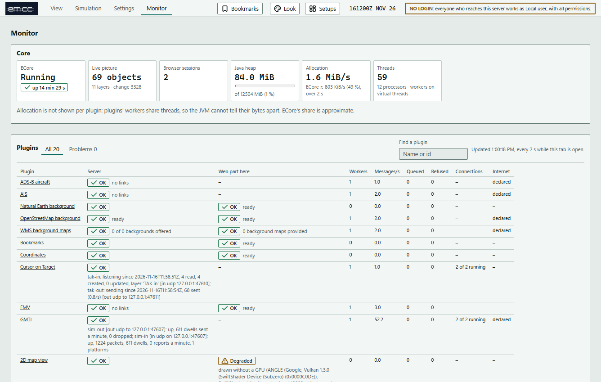
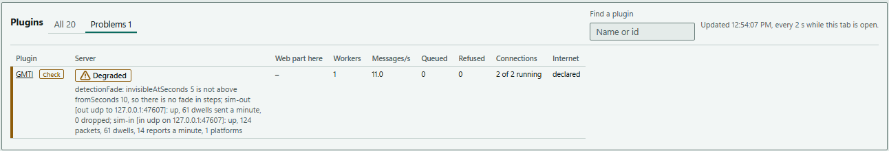

# The Monitor workspace

The Monitor shows how emcc is doing: the server, each plugin, and the workers that run inside the server. It is for administrators. It is the last tab in the top bar, and only users with the permission to administer settings see it.

The page updates itself every 2 seconds while the tab is open. The line at the right of the plugin table says when it was last updated.

The [Status](03-16-status.md) panel in the View workspace is a short version of the first two parts of this page, for everyone.

## Core

Six cards show the state of the server's core.

| Card | What it shows |
|---|---|
| ECore | The state of the server's core, for example Running, and for how long it has been up |
| Live picture | How many objects the server holds, how many layers, and a number that counts every change |
| Browser sessions | How many browsers are connected to the live map |
| Java heap | The memory the server uses, with a bar, and how much it may use |
| Allocation | How fast the server takes memory, for example `1.3 MiB/s`, and ECore's share of it |
| Threads | How many threads the server runs, how many processors it has, and that the workers run on virtual threads |

A line under the cards says that allocation is not shown for each plugin, because the plugins' workers share threads, so the server cannot tell their bytes apart. The share of ECore, the server's core, is approximate.

## Plugins

A table with one row for each plugin. Above it are two tabs, **All** and **Problems**, each with a number, and a field **Find a plugin**. The field filters the table by a part of the name or of the id of a plugin. **Problems** lists the plugins that need a look, and says "No plugin needs a look" when there are none.

| Column | What it shows |
|---|---|
| Plugin | The plugin's name. Click it to open more about the plugin under its row, and click it again to close that |
| Server | The state of the plugin's part on the server, as a chip, with a short text, for example "no links" or "ready". A chip such as OK, Degraded or Disabled is shown for every plugin |
| Web part here | The state of the plugin's part in your browser. A plugin that has no part in the browser shows a dash |
| Workers | How many workers the plugin runs. A worker is a task inside the server that does the plugin's work |
| Messages/s | How many messages per second the plugin handles |
| Queued | How many messages wait for the plugin |
| Refused | How many messages the plugin refused because it was too busy |
| Connections | The plugin's connections to other systems, for example "2 of 2 running" for the links of GMTI |
| Internet | "declared" if the plugin is allowed to go to the internet or a network, otherwise a dash |

A plugin's state is a chip: **OK**, **Degraded** or an error. Degraded means that the plugin works with limits and says why. A row that needs a look has a coloured bar at its left and the tag **Check** after the name; a plugin that has failed or is disabled has the tag **Problem**. The map view says "drawn without a GPU" when the computer has no graphics card. That is not an error.

An error is shown with its reason. Check the server's log in the `logs` folder for more.

### More about a plugin

Click the name of a plugin and a part opens under its row. It shows:

- how many calls wait for the plugin and how many timers it has, each with its limit,
- the hosts that the plugin may reach, where it has declared any, and what it may connect to,
- the plugin's **workers**: a table with the worker's name, its state (RUNNING, or another state that says what is wrong), how many messages wait, how many per second it handles, the average and the longest time to handle one, and how many times it failed, hung, was restarted and lost messages,
- for a plugin with links, its **connection tasks**: one row for each running link, with its state, for how long it has run, its restarts, the address it listens on or the peer it is connected to, its counters, how many messages wait in its inbox and when it last did anything,
- for a plugin that sends, its **output channels**,
- for the Terrain plugin, its folders and whether they can be read.

Some plugins say more in the Server column or in the part under the row:

- **Cursor on Target** says "no link configured" before you add a link. Each link is a connection task: a link that receives says that it is listening, and how many events it has read, created and updated, and which layer it writes to; a link that sends says since when it has sent and how many events it has sent.
- **GMTI** says in the Server column how each link is doing, for example "sim-in [in udp on 127.0.0.1:47607]: up, 124 packets, 61 dwells, 12 reports a minute, 1 platforms". A link that receives says how many packets, dwells and reports a minute it gets and how many platforms it knows. A link that sends says how many dwells a minute it sends and how many it dropped. The Connections column says "2 of 2 running". GMTI is Degraded, with the reason, when a fade setting or a colour is not valid: see [GMTI](05-14-gmti.md).
- **Terrain** says "Height data: 6 cells (level 2: 2, level 1: 2, level 0: 2)" when it has found height data, "Height data: 0 cells" when the folder is there but empty (a new release), or "Height folder not set".
- **NVG** says "no links" before you add a link. For a link that reads it gives the time of the last call, what it did ("6 items, 6 created, 0 updated, 0 deleted") and the time of the next call. For a link that offers it gives the calls answered, the address and time of the last caller, and the items served. See [NVG](05-23-nvg.md).
- **FMV** says "no links" before you add a link. When a link receives a stream, its part also has a table of **streams** (the viewers of each stream, what comes in and goes out, what is dropped and how often a viewer lost frames) and, for MPEG-2, a table of **conversions** (the state of each conversion, what goes in and out, the processor time and details). For an output link it also shows the channel, the folders of imagery and heights, the encoder and the compute task of each camera that sends: see [FMV output links, imagery and terrain](05-24-fmv-output.md). See [FMV: full motion video](03-19-fmv.md).
- **UAV simulation** counts its cameras and says how many run, how many poses it made and sent in the last minute, and how many of its outputs do not send. It is Degraded while the output of a running camera is missing.
- **Simulator** counts its routes, tracks, sensors and the items it has sent, in a long line that tells how its simulation is doing: how many routes run, how long the last tick took, and how many moves and outputs were sent or refused.

## Core workers

A table with one row for each worker of the server's core: for example the one that stores objects, the one that expires objects, and one for each connected browser.

| Column | What it shows |
|---|---|
| Worker | The worker's name |
| State | RUNNING, or another state that says what is wrong |
| Queued | How many messages wait, out of how many fit |
| Messages/s | How many messages per second it handles |
| Average ms, Longest ms | How long it takes to handle a message |
| Failures, Hung, Restarts, Lost | How many times the worker failed, stopped responding, was restarted by the server, and lost messages |

In a healthy system the numbers in the last four columns are 0. A worker that fails or hangs is restarted by the server. If you see numbers that grow, see [Known limits and troubleshooting](90-02-limits.md).
