# Setting up a GMTI simulation

In this guide you build a small GMTI simulation: a convoy of four ground units drives along a route, and an aircraft with a ground moving target indicator (GMTI) radar flies a ring round it. The radar looks at the convoy, and its reports reach the map as detections, as a real GMTI system would send them. It takes about twenty minutes the first time.

## What you get

- A **ground route** in the middle of the map and an **air route** that circles round it.
- **Four ground units** that drive along the ground route in a convoy, and **one aircraft** that flies the air route again and again.
- A **radar on the aircraft**, set to look at the side where the convoy is, so that it detects the ground units.
- A **GMTI link** that sends the radar's reports, and another that receives them in the same emcc, so that you see the dwells, the detections and the pairing lines in the View workspace.

## What you need

- The permission to edit Simulation, and, for step 1, the permission to administer settings. See [Users and permissions](01-03-permissions.md). Without a login you have them all.
- An emcc that runs. Starting it is described in [Running emcc](01-02-running.md).
- An empty Simulation, to see only your own tracks. If there are routes from an earlier job, look at [Routes](04-02-routes.md) for how to reset or remove them.

The routes in this guide lie near 61.6 N 15.4 E. Any other place works, since the radar is described in distances and directions. The pictures show the Natural Earth map.

## 1. Make the links

The radar's reports are sent to a **GMTI link** that sends, and a second link receives them again, on this computer, into a layer that the View workspace shows. Skip this step if you already have such a pair.

1. Open **Settings**, then **GMTI** under Data Links.
2. Click **Add link** above the table. In the form on the right write the name `sim-out`, and set Mode **udp**, Direction **out**, Host `127.0.0.1` and Port `47607`. Click **Save link**.
3. Click **Add link** again for a second link. Write the name `sim-in` and set Mode **udp** and Direction **in**. Click **Set Listen on**, and write the address `127.0.0.1` and the port `47607`. For **Layer**, click the **+** button next to the list and make a new layer called `GMTI in`. Click **Save link**.
4. Open the **Monitor**. In the row of GMTI, **Connections** must say "2 of 2 running", and the text in the Server column must say that both links are **up**. Click the name **GMTI** to see each link as a connection task.

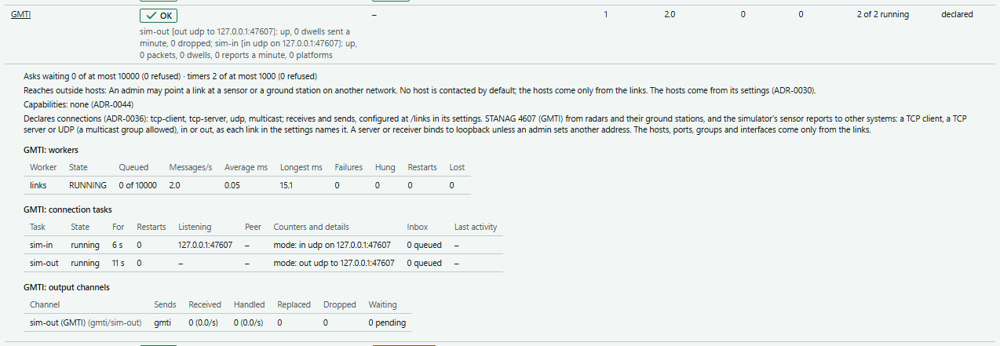

Every field of a link is described in [GMTI](05-14-gmti.md). [GMTI](03-17-gmti.md) has the same pair under "Trying it without a radar".

## 2. Draw the two routes

A route is a line that tracks follow. See [Routes](04-02-routes.md) for all of it. You need two.

The speeds in this guide are in km/h and the heights in metres, which is what the Routes panel shows unless you have chosen other units. Check **Speed unit** and **Altitude unit** at the top of the Routes panel.

Open the **Simulation** workspace. Open the **Routes** panel in the left pane. Then choose the place and the scale: click **Coordinates** on the map, write `61.6 15.4` in the **Go to** field and press Enter, and zoom in until the scale bar says **10 km**.

### The ground route

1. Click **New route**.
2. Click three points near the middle of the map, from left to right, a bit less than two scale bars apart in all: the route is about 20 km long. Finish with a double-click on the last point.
3. The **Route editor** opens in the right pane. In **Name**, write `Ground route`.
4. Under **All points**, set **Speed change** to **Step at this point**, write `40` in **Speed (km/h)** and click **Set on all points**. A box asks "Change all 3 points"; confirm it.

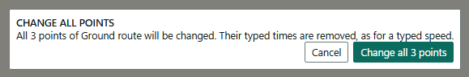

The speed is the speed of the ground units. Close the Route editor with its close button.

### The air route

1. Click **New route** again.
2. Click a ring round the ground route, **clockwise**: start in the west, go north, then east, then south, and come back to the start. Eight or nine points make a smooth ring. The ring in the picture is about 55 km across, so the ground route is well inside it. Finish with a double-click on the first point again, so that the ring is closed.
3. In the Route editor, write `Air route` in **Name**, and set **At the end** to **Restart**: when the aircraft has flown the ring, it starts again.
4. Under **All points**, set **Speed change** to **Step at this point** and `Speed (km/h)` to `360`, and **Altitude change** to **Step at this point** and `Altitude (m)` to `5000`. Click **Set on all points** and confirm.

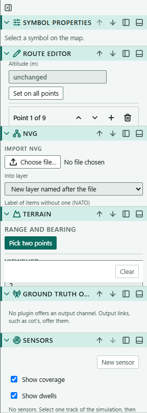

The map now shows both routes, and the Routes panel lists them.

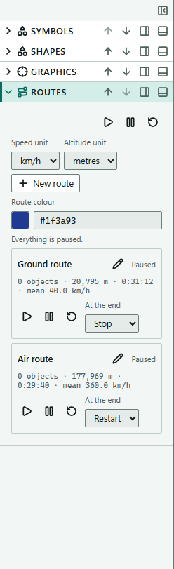

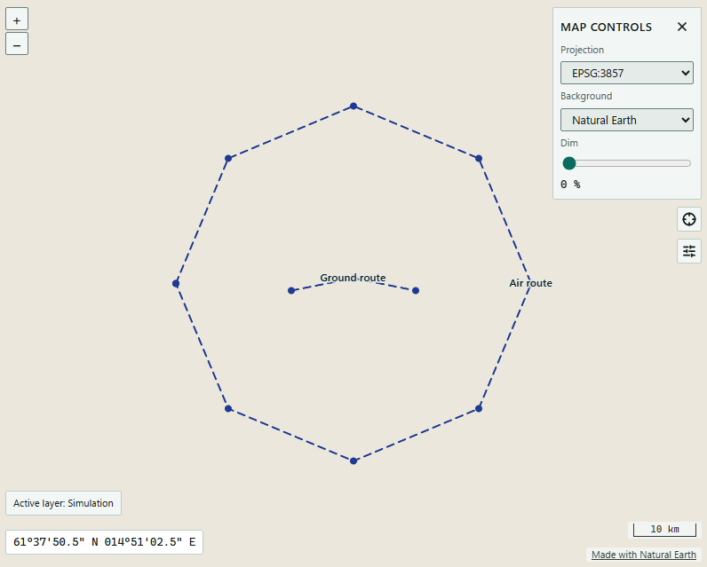

The ring goes **clockwise** for a reason: in step 5 the radar looks to the right of the aircraft, and on a clockwise ring the middle of the ring is always on the right.

## 3. Make the units

The units are symbols in the Simulation layer. See [Symbols](03-09-symbols.md) for the Symbols panel.

### Four ground units

1. Open the **Symbols** panel. Choose the category **Land equipment** and the identity **Hostile**.
2. Click the symbol **Armour**, then **Place on map**.
3. Click four times on the map, in a row below the ground route, a little apart. Press Escape.

### One aircraft

1. In the Symbols panel, choose the category **Air** and the identity **Friend**.
2. Choose a fixed wing aircraft and click **Place on map**.
3. Click once on the map, near the western end of the air route. Press Escape.

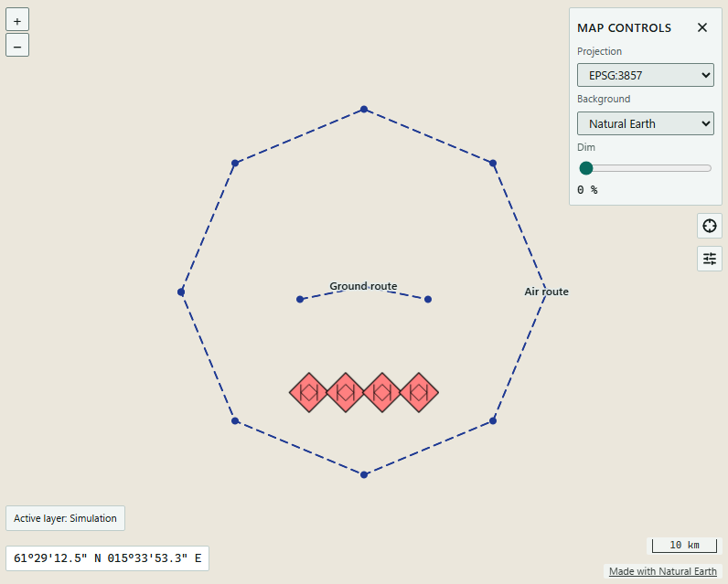

The units stand still until they are on a route. They have no names yet: a unit gets its name from the route.

## 4. Put the units on the routes

### The convoy

1. In the **Objects** panel at the bottom, choose the layer **Simulation**. Select the four ground units: click the first and click the others with the Control key held down.
2. Right-click one of them and choose **Put on route**.
3. Choose **Route**: `Ground route`, **Kind**: **Convoy**, and **Spacing (m)**: `150`.
4. Click **Put on route**.

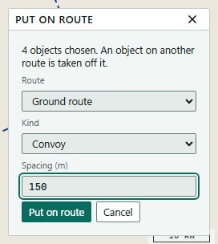

The units get the names `Ground route-1` to `Ground route-4`. In a convoy they wait at the first point and leave one by one, each when the one in front of it is 150 m away.

### The aircraft

1. Select the aircraft in the Objects list. It is the symbol that is not on a route.
2. Right-click, choose **Put on route**, **Route**: `Air route`, **Kind**: **Each on its own**, and click **Put on route**.

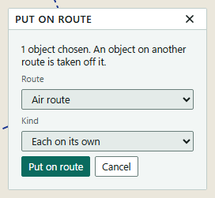

The aircraft is called `Air route-1`. A track only moves when its route runs, so nothing moves yet.

## 5. Make the radar

A sensor belongs to a track. Select the aircraft, `Air route-1`, in the Objects list or on the map. Open the **Sensors** panel in the right pane and click **New sensor**. The sensor is a **ground radar**: it looks at the ground, as a GMTI radar does.

Set these values. The next section explains each of them.

| Setting | Value | Why |
|---|---|---|
| Start bearing, End bearing | `45` and `135` | The radar looks to the right of the aircraft |
| Min range, Max range | `5` and `50` km | The ground route is about 20 to 40 km from the aircraft all the way round |
| Range error, Cross-range error | `50` and `100` m | A realistic scatter of the positions |
| Minimum detectable speed | `10` km/h | Slower units are not seen. The convoy goes at 40 km/h |
| Probability of detection | `1` | Every unit in the area is detected at each revisit |
| Preset | Medium wedge (the default) | A dwell of 40°, up to 50 km deep (never deeper than the range band), every second |
| Mode | Random (the default, set by the preset) | The dwells are placed over the units, and the revisit is filled with empty dwells |
| Sensor outputs | tick `sim-out` | The reports go to the link from step 1 |

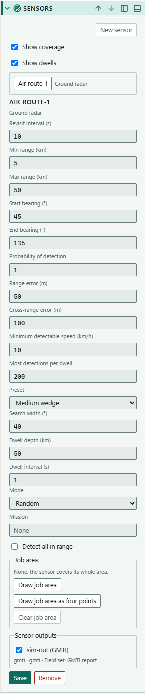

Click **Save**. The map now draws the radar's **coverage**: the sector that it looks at, with its bearings and its ranges.

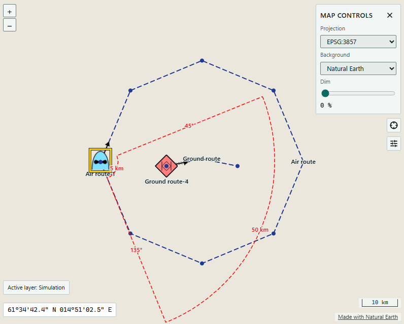

### What the radar's settings mean

**The arc: bearings and ranges.** The radar looks at a part of a ring round the aircraft: between a **minimum range** and a **maximum range**, and between a **start bearing** and an **end bearing**. The bearings are counted **clockwise from the direction in which the aircraft flies**, and not from north. 0° is straight ahead, 90° to the right and 270° to the left. So the arc turns with the aircraft: on a ring that the aircraft flies clockwise, the middle of the ring stays at about 90°, and 45° to 135° covers it. Equal bearings, for example 45° and 45°, mean all the way round. Together with the ranges the arc is the radar's **search area**. See [Sensors](04-04-sensors.md).

**The dwell rate.** A radar does not look at its whole area at once. It looks at one patch, a **dwell**, and then at the next. The **dwell interval** is the time from one dwell to the next (1 s here), the **search width** and the **dwell depth** are how wide and how deep a patch is (40° and 50 km), and the **revisit interval** is the time for one round through the whole area (10 s). In the **Random** mode, the default, the radar fills each revisit with one dwell for each dwell interval, here 10 dwells in 10 seconds. The dwells with units come first, and the others are empty on purpose, because a real radar also looks at ground where nothing is. A dwell is one report. A report says where the radar looked, and what it found there. The **preset** sets the dwell values and the mode together: the Default preset looks at a small patch (2°) very often, the Wide wedge at a large patch rarely, and the **Narrow wedge** is a narrow beam that scans the area in rows in the **Systematic** mode and gives each unit that it finds a dwell of its own every two seconds. See [Sensors](04-04-sensors.md).

**The required speed.** A GMTI radar sees only what moves, and only the part of the movement that goes **towards it or away from it**. The **minimum detectable speed** is the lowest of that speed that the radar sees. A unit that drives across the radar's line of sight is slow in the radar's eyes, and is not seen, even if it is fast. A unit that stands still is never seen when the minimum speed is above 0. In this guide the convoy goes at 40 km/h. At the start of the ring it drives straight away from the aircraft, so it is seen at once. Later, on the sides of the ring, it crosses the line of sight, and it is seen less often. A radar with a minimum of 60 km/h sees nothing, because the convoy is slower than that.

**The error offsets.** A real radar does not measure a position exactly. The **range error** is how far the measured position may be from the true one along the line from the aircraft, and the **cross-range error** how far across that line. Both are one standard deviation, so most detections lie closer than that, and some lie farther away. With 0 and 0 every detection is exactly on its unit. A radar measures worse across the line than along it, so the cross-range error is the larger one here.

**The probability of detection.** With less than 1, a unit that is in the area is missed at some revisits, at random.

## 6. Run it

1. In the Routes panel, click **Start all routes**.
2. The units start to move. The aircraft flies the ring. The map draws the dwells of the radar, one after the other, in green (the radar's coverage is red), and a yellow **pairing line** from the aircraft to each unit that the radar detects.
3. After a minute or two (the first reports can take a while), open the **View** workspace and choose the layer `GMTI in` in the Objects panel. The layer has the platform (the aircraft), its dwell areas (green, one for each revisit, with no name), its coverage, and detections with the data type **GMTI detection**.

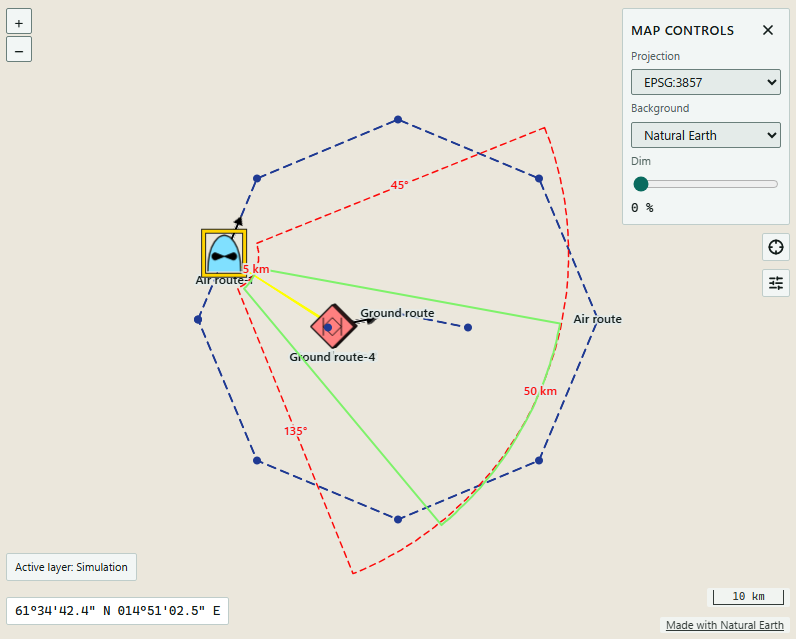

Select a detection in the list and choose **Zoom to object(s)** in its menu. The detections of one unit lie round its true position, scattered by the errors you set. Older detections are fainter: they fade in steps, see [GMTI](03-17-gmti.md).

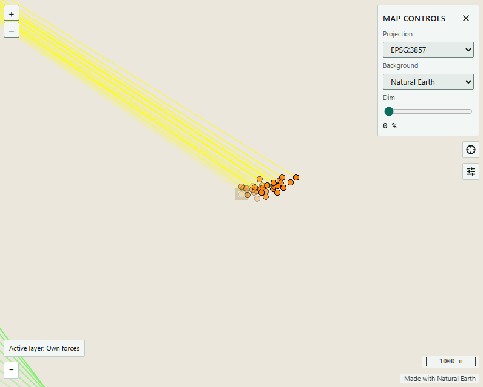

Click **Pause all routes** to pause, and **Reset all routes** to start again from the beginning.

## When nothing is detected

| What you see | Why, and what to do |
|---|---|
| No dwells on the Simulation map | The radar has no output, or the routes do not run. Check **Sensor outputs** in the Sensors panel, and click **Start all routes**. A paused simulation sends nothing |
| Dwells, but no detections | The convoy is not inside the search area. Look at the coverage on the map: it must be on the side of the aircraft where the convoy is. A ring that the aircraft flies **anticlockwise** needs the bearings 225° to 315°. Or the **Minimum detectable speed** is above the speed of the units |
| Dwells and pairing lines in the Simulation workspace, but nothing in View | The link that receives is not up (the Monitor says), or the layer `GMTI in` is not switched on in the Layers panel. See [Layers](03-14-layers.md) |
| Only some of the units are detected | The others have not left the first point yet, or are across the radar's line of sight, or are out of range. A **Probability of detection** under 1 also makes some detections miss |
| The detections are far from the units | The errors are large. Check **Range error** and **Cross-range error** |

To see that the rest of the set-up is right, tick **Detect all in range** in the Sensors panel for a minute. The radar then detects every track within its maximum range, at its true position. Untick it again to get the real behaviour.

## Things to try

- Set both errors to 0 and look at the detections: they are exactly on the units.
- Set **Minimum detectable speed** to 60: the convoy is too slow to be seen.
- Set the bearings to 0 and 360 for a radar that looks all round, and see how the radar then sees all the units that move towards or away from it.
- Draw a **job area** for the sensor, so that it looks only at a part of its search area. See [Sensors](04-04-sensors.md).
- Change the preset to **Narrow wedge**, and watch the dwells: the radar scans its area in rows, one narrow dwell next to the other, and a dwell of its own follows each unit that it finds.
