# Setting up the UAV simulation

In this guide you set up a **simulated camera** on a moving track, and watch its video in emcc. You start with an emcc that has no height data and no photographs, make an output link and an input link for the video, put a camera on a track, and end with a picture of the ground, drawn from the camera's position, playing in the FMV panel.

The guide is for two people. An **administrator** sets up what the picture is drawn from and the links. An **operator** makes the camera and flies it. Often they are the same person.

## What you get

- A **track** in the Simulation workspace that moves along a route, as a UAV does.
- A **camera** on the track, pointed at a place on the ground, that makes one picture for every frame.
- An **output link** that sends the pictures as STANAG 4609 video over UDP, and an **input link** that receives them in the same emcc.
- The video in a **window** in View, with the camera and its field of view on the map.

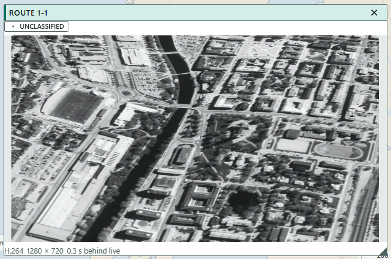

## What you need

- The permissions. The administrator needs **Settings: administer**. The operator needs **Simulation: view** and **edit**, **Cameras: view**, **edit** and **run**, and **FMV: watch**. See [Users and permissions](01-03-permissions.md). Without a login everyone has them all.
- An emcc that runs, as in [Running emcc](01-02-running.md). The camera works without the internet.
- A browser that plays H.264 video. The pictures in this guide were taken in Edge.
- A free UDP port on the computer. The guide uses `47621`.
- The photographs and the height data, which are not in the release. You bring both: an orthophoto set of your own and your own DTED files. Step 1 says what they are, and steps 8 and 9 put them in. They must cover the same place, and the camera looks at a point in the middle of a route of about 5 km. The pictures in this guide use a set of four tiles, 2.5 km square each, side by side, and height data over the same place.

The values are examples that work together. Change them when you know why. The coordinates in steps 4 and 5, `62.392 17.30`, are those of the place that the pictures show: write the coordinates of a place inside your own photographs and height data instead. The pictures show the OpenStreetMap background, because it shows streets at this scale. Natural Earth works too, but shows nothing at a scale of 1 km.

## 1. What the picture is made from

A camera does not film anything. emcc **draws** its picture, frame by frame, from five things. Two of them you must put in, one is optional, and two are in the release already.

| What | What it is, and where it goes | Without it |
|---|---|---|
| **Height data** | DTED cells (files `.dt0`, `.dt1` and `.dt2`) in `settings/terrain` in the emcc folder, one subfolder for each cell. This is the folder that **Terrain folder** names in Settings, under FMV. The Terrain tools read the same folder by default | The ground is **flat at 0 m**. The setting's own hint says so: *empty ground is flat at 0 m* |
| **Imagery** | One **imagery set**: a subfolder of `settings/imagery` with aerial photographs as tiles and a file, `imagery.json`, that says where each tile lies. This is the folder that **Imagery folder** names | The ground is **plain grey** |
| **A WMS** (optional) | A map server that fills in where the imagery set has no tile. Off by default. Step 11 | The ground without a tile stays grey |
| **The encoder** | `tools/ffmpeg/ffmpeg.exe`, which is in the release. emcc runs it to make H.264 video from the pictures | The camera makes its poses but sends nothing, and says *No encoder installed*. See the table at the end |
| **The permissions** | Lines in `settings/emcc.properties`. They are in the release already | With a login, nobody sees the Cameras panel, or the video |

**The height data.** You bring DTED files of your own, from a source that you may use, and put them into `settings/terrain` in the emcc folder, one subfolder for each longitude and one file for each cell and level, for example `e011/n59.dt2`. They must cover the place where the camera looks. Nothing needs to be set: the folder is where emcc looks. See [Terrain](05-20-terrain.md) for the format.

**The imagery.** emcc comes with no photographs. You bring a set of your own. Each tile is a JPEG or PNG file, and `imagery.json` lists them:

```
settings/imagery/orthophotos-example/imagery.json
settings/imagery/orthophotos-example/tile_0_0.jpg
```

```
{
  "name": "orthophotos-example",
  "source": "Example orthophotos",
  "licence": "CC0-1.0",
  "crs": "EPSG:3006",
  "tiles": [
    { "file": "tile_0_0.jpg", "min": [616760.25, 6919844.80], "max": [619260.25, 6922344.80], "width": 2500, "height": 2500 }
  ]
}
```

- `source` and `licence` are **required**. A set without them is refused.
- `crs` is `EPSG:3006` (SWEREF 99 TM, metres: easting and northing) or `EPSG:4326` (WGS84: longitude first, then latitude).
- `min` and `max` are the **outer corners** of a tile, lower left and upper right. `width` and `height` are the picture's size in pixels, and the file must have that size.
- One camera uses **one set at a time**: the first one, by folder name, that covers the camera. It uses at most about **256 million pixels** of tiles, the nearest first, and the rest of the ground is grey.

Every key of the file is described in [FMV output links, imagery and terrain](05-24-fmv-output.md), with the rules for the corners.

## 2. Check the permissions

The release's `settings/emcc.properties` has these lines already. You need them only when emcc runs with a login, and only if you want to change the groups:

```
emc2.login.oidc.permissions[plugin.uav-simulation.view]=sim-viewers
emc2.login.oidc.permissions[plugin.uav-simulation.edit]=sim-editors
emc2.login.oidc.permissions[plugin.uav-simulation.run]=sim-runners
emc2.login.oidc.permissions[plugin.fmv.view]=*
```

The three Cameras permissions go to the groups that have the same permissions in Simulation. The `*` means **everyone who has logged in**: every user may watch the video. To keep the video to some groups, write their names there instead. See [Users and permissions](01-03-permissions.md) and [Plugins from others](08-07-plugins.md).

## 3. Make the output link

The output link is the part of FMV that draws the pictures and sends them.

1. Open **Settings**, then **FMV** under Data Links.
2. Look at the page. The group **Compute threads** says how many cameras may be drawn at once. **Imagery folder** and **Terrain folder** name the two folders of step 1, and **WMS imagery** is the optional map server.

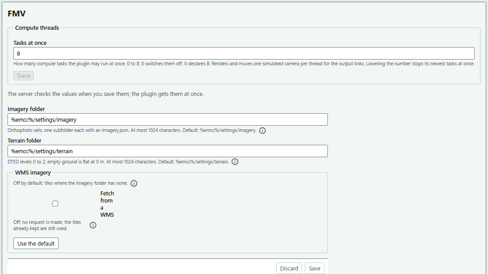

3. Click **Add link** above the table. In the form on the right write the name `Camera out` and set **Direction** to **out**. Click **Save link**. Leave **Address** and **Port** empty for now.

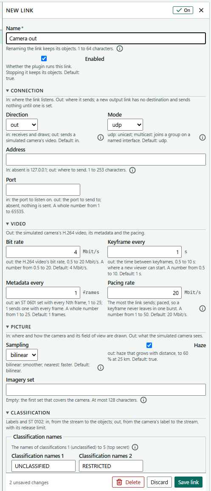

A new output link has **no destination**, and it sends nothing until it has an address and a port. Step 5 shows what that looks like.

Every field of a link is described in [FMV output links, imagery and terrain](05-24-fmv-output.md).

## 4. Put a track on a route

The camera needs a **platform**: a symbol in the Simulation workspace that has a position, a direction and a speed. A symbol that drives along a route has them all. See [Routes](04-02-routes.md) for the Routes panel and [Symbols](03-09-symbols.md) for the Symbols panel.

1. Open the **Simulation** workspace.
2. Click **Coordinates** on the map, write `62.392 17.30`, or the coordinates of a place inside your data, in the **Go to** field and press Enter. Zoom until the scale bar says **1000 m**.
3. In the **Routes** panel click **New route**. Click four points on the map, from west to east, and finish with a double-click on the last. The route is a bit over 5 km long. Close the Route editor that opens.
4. In the **Symbols** panel choose a symbol, for example **Command and control**, and click **Place on map**. Click once on the map near the first point of the route, and press Escape.
5. Right-click the symbol and choose **Put on route**. In the box choose **Route 1** and click **Put on route**. The symbol is now a **track** on the route, and its name is **Route 1-1**.

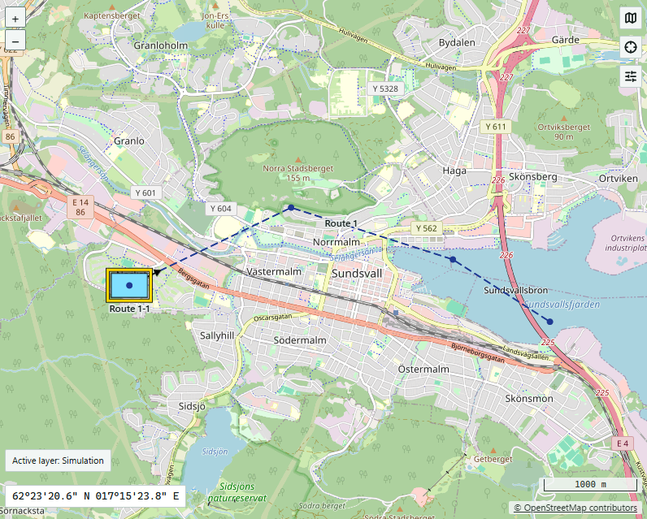

The track moves only while its route runs. You start it in step 5.

## 5. Make the camera, and start it

1. Right-click the track and choose **New camera**.

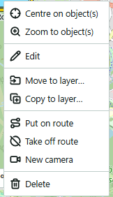

The **Cameras** panel opens in the right pane with a new camera on the track. A track has **one** camera, and there can be at most **50**. **New camera** on a track that has one opens that camera.

2. Set **Pointing mode** to **Track a point**. Write the longitude `17.30` and the latitude `62.392`, which is the middle of the route (or the middle of yours). Leave the point's height at `0`.
3. Write `RECCE NORTH` in **Mission**, and choose **Camera out** in **Output**. The other fields keep their values: a field of view of 20°, a frame of 1280 × 720, 25 frames a second, and a height of 1000 m for a track that has no altitude.

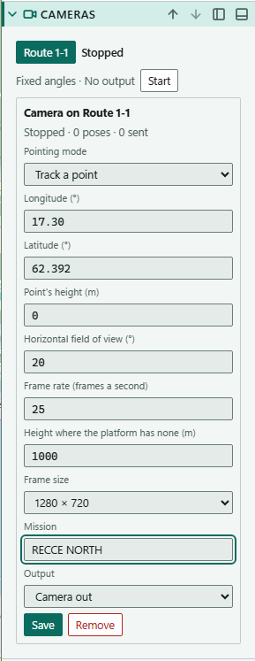

4. Click **Save**, then **Start** in the camera's row. Then click **Start Route 1** in the Routes panel, so that the track moves.

The camera now makes a pose for every frame, but the panel says that it is **not sending**:

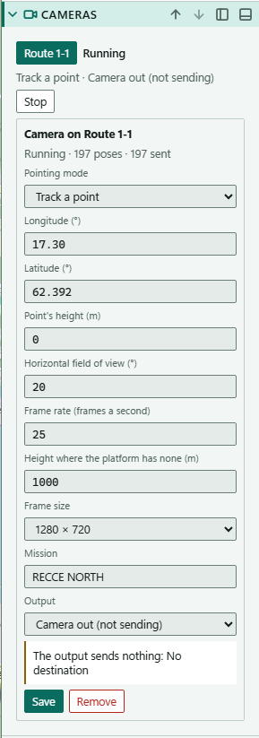

The line under the output says *The output sends nothing: No destination*. The **Monitor** says the same, and its FMV row is **Degraded**:

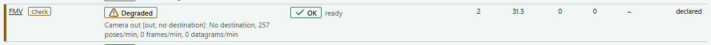

This is what a link says when it cannot send. The camera goes on, and it sends again as soon as the link can.

## 6. Give the output link a destination

The video is sent to an address and a port. A receiver that listens there gets it. Here you send it to this computer.

1. Open **Settings**, then **FMV**, and click **Camera out** in the table.
2. Write `127.0.0.1` in **Address** and `47621` in **Port**. Leave **Mode** at **udp**. Click **Save link**.

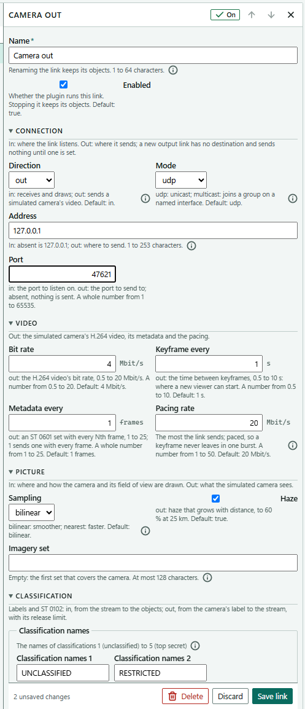

The camera's panel stops saying *not sending*. The link is **Ready**.

## 7. Watch the video

To see the video in emcc you need a link that **receives** it, on the same port.

1. In Settings, under FMV, click **Add link**. Write the name `Camera in`, set **Direction** to **in** and write `47621` in **Port**. The address stays empty: an input link listens on 127.0.0.1.
2. Next to **Layer**, click the **+** button. Make a layer called `Camera feed`. The camera and its field of view will be drawn there.
3. Click **Save link**.

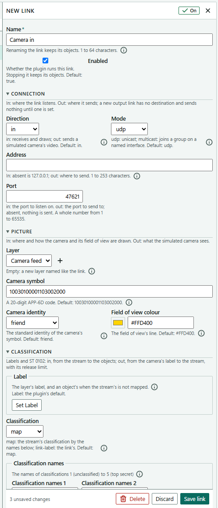

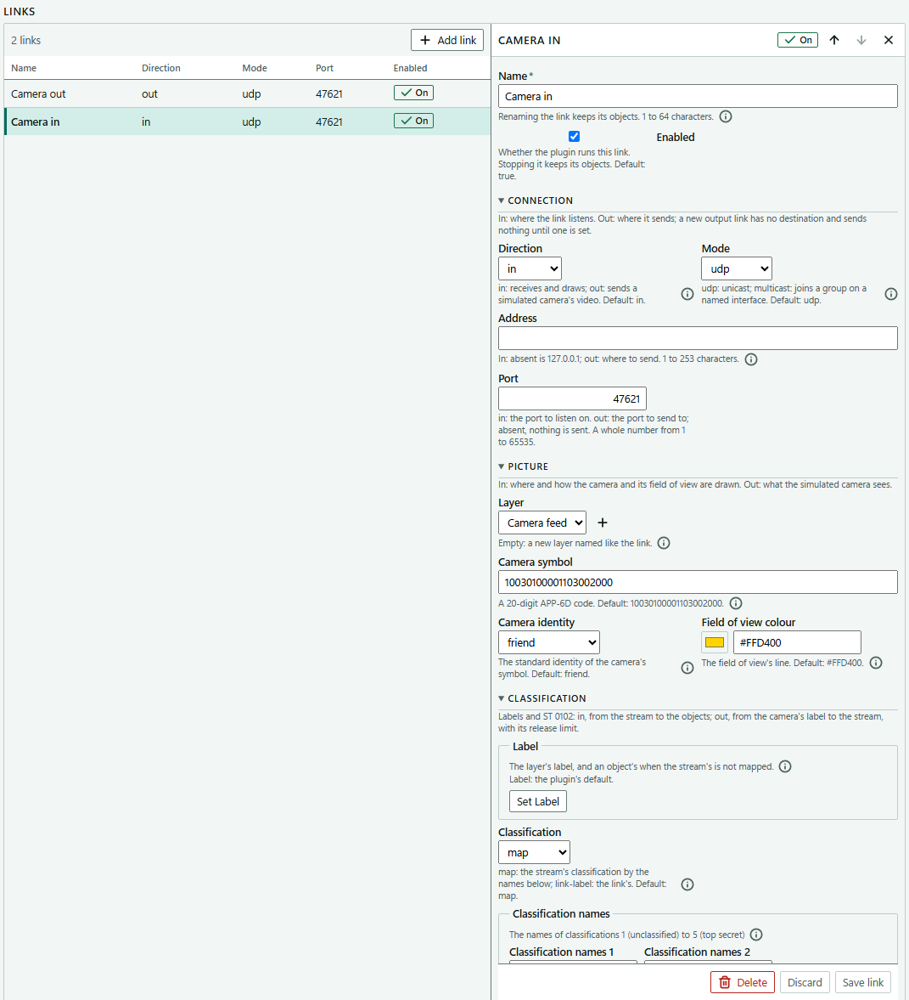

The camera's panel and the Monitor now say that the camera runs and sends:

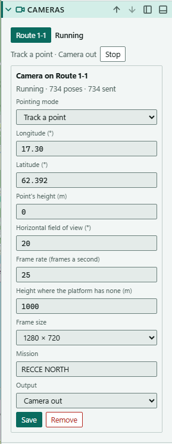

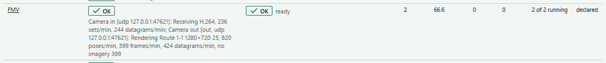

4. Open the **View** workspace. The **FMV** panel lists the stream: the camera `Route 1-1`, the link `Camera in`, H.264, 1280 × 720, and **Live**. The camera is on the map with its field of view as an arc.

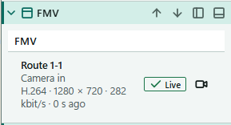

5. Click the **Watch** icon in the row. A window opens with the video.

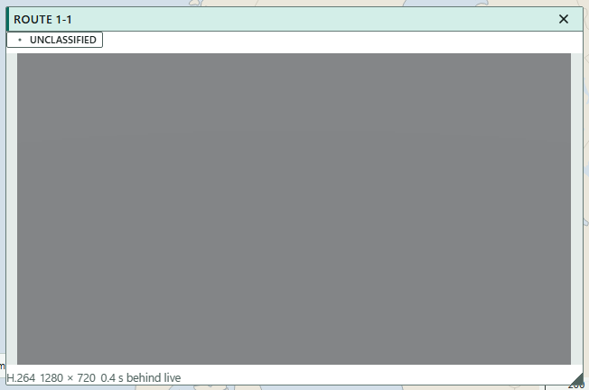

It works, but the ground is **grey**. The camera has nothing to draw the ground from yet. The next two steps put it in. The row in the Monitor says it too: **no imagery** counts the pictures that had no photograph. See [FMV: full motion video](03-19-fmv.md) for the panel and the window.

## 8. Put in the imagery

1. Make the set as in step 1: a folder with the tiles and an `imagery.json` in `settings/imagery`, for example `settings/imagery/orthophotos-example`.
2. Click **Pause Route 1** in the Routes panel, so that the track stands still and you can compare the pictures of this step and the next.
3. In the Cameras panel, **Stop** the camera. **Wait about five seconds**, then click **Start**. Open the window again if it closed.

A camera reads the folders when it starts its picture work. A camera that is stopped and started again within a second or two goes on without having read the new files, so wait a few seconds.

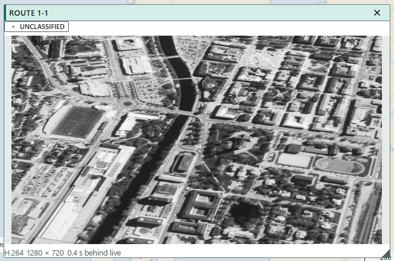

The Monitor's FMV row now names the set, with its source and its licence:

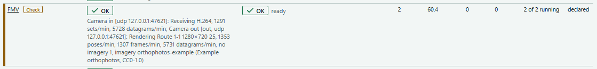

A set is used only if it has a **source** and a **licence**. Try it: make a second folder, `settings/imagery/a-no-licence`, with an `imagery.json` that has no `licence`, and stop and start the camera. The camera still draws from the first set, and the Monitor names the second as refused:

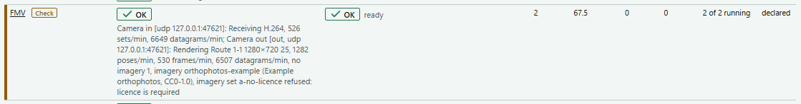

Take the folder away again. The set that covers the camera is used; if several sets cover it, the first by folder name is.

## 9. Put in the height data

1. Put your DTED files into `settings/terrain`, as in step 1.
2. **Stop** the camera, wait about five seconds, and **Start** it again. The track is still paused.


Compare it with the picture of step 8: the same camera and the same pose, but the ground has its heights. The picture is a little different, in what it shows and in how it is tilted, because the ground is higher than 0 m. Where the land is hilly the difference is greater. Click **Start Route 1** to let the track move again.

## 10. The other pointing modes

The camera has four modes. You change the mode in the camera's form, then **Save**. A running camera uses the change from its next frame. [A simulated camera](04-06-camera.md) describes every field.

| Mode | What it does | The fields |
|---|---|---|
| **Track a point** | Looks at one place on the ground as the track moves past it | The longitude and latitude of the point, and its height |
| **Track an object** | Looks at another symbol of Simulation as it moves, for example a vehicle on another route | The **Target**, which you pick with **Use selection** after you select the symbol on the map |
| **Fixed angles** | Looks in one direction **relative to the track's heading**, so it turns with the track. Azimuth 0° is straight ahead | **Azimuth** and **Depression** |
| **Sweep** | Pans back and forth between two azimuths, relative to the heading. 315° to 45° is a sector of 90° round straight ahead | **Sector start**, **Sector end** and the **Sweep rate**, and the depression |

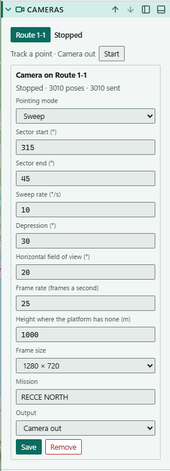

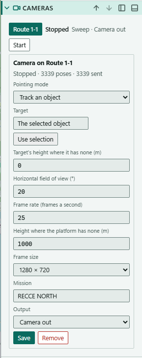

## 11. A WMS for the ground that has no photograph (optional)

If the camera may look outside your imagery set, a **WMS** can fill in the ground there. It is off by default.

1. In Settings, under FMV, tick **Fetch from a WMS** in the group **WMS imagery**.
2. Write the **Server** (the WMS 1.3.0 address, without parameters) and the **Layer**. Choose the **CRS** and the **Format**, and the **Tile size** and **Ground resolution** if the defaults do not suit the server.
3. Write the **Source** and the **Licence** of the map. Nothing is fetched without both.
4. Click **Save** at the foot of the page, under the group. Stop the camera, wait a few seconds, and start it.

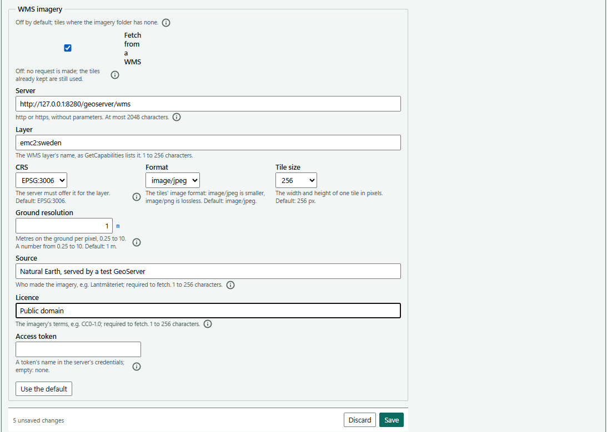

Only the **server** of emcc talks to the WMS, never the browser, and only to the address you write here. Only WMS version 1.3.0 is used. Where the imagery set has no tile, emcc asks the WMS for the tiles within 2 km of where the camera looks, and keeps them. The Monitor says what is happening:

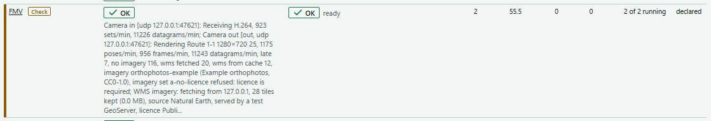

**The kept tiles work offline.** Once an area has been flown, its tiles are kept. With the WMS server stopped, flying the same area again draws it from the kept tiles: the row counts them as *wms from cache*, and no failure is counted. At most 900 tiles are kept; the least recently used go first.

## 12. Stop

Click **Stop** in the Cameras panel to stop the camera, and **Pause Route 1** to stop the track. To make the camera go away, open it in the Cameras panel and click **Remove**. The links stay.

## What the camera and the link say

The **Cameras panel** says what the camera is doing, and what its output link says back. The **Monitor** shows the same from the link's side, in the row of FMV and in the Monitor's list of output channels. See [A simulated camera](04-06-camera.md) for the panel and [Monitor](06-00-monitor.md) for the Monitor.

| The camera's output | The Monitor's FMV status | Means |
|---|---|---|
| **Camera out** (no mark) | OK | The link is **Ready**: it sends the video |
| **Camera out (not sending)**, with the line *The output sends nothing: ...* | **Degraded** while it lasts | The link is **Not sending**, and the line says why: *No destination*, *No encoder installed*, and others |
| **Camera out (degraded)** | See the line | The link says that it is **Degraded**, and the line says which fault |
| **Camera out (missing)**, and the camera's state **Output missing** | OK | The link is switched off or gone. The camera goes on and sends again when the same link is back |

The camera's own state says whether it runs: **Running**, **Stopped**, **Platform gone**, **Target gone** and **Output missing**.

The states that you may meet in this guide look like this.

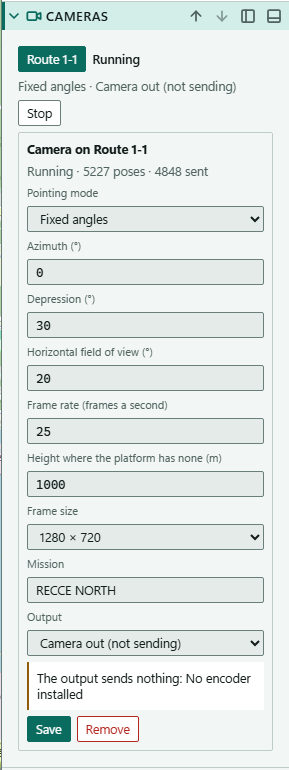

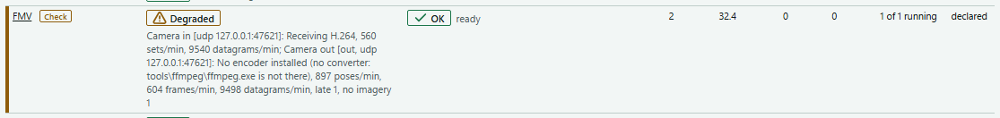

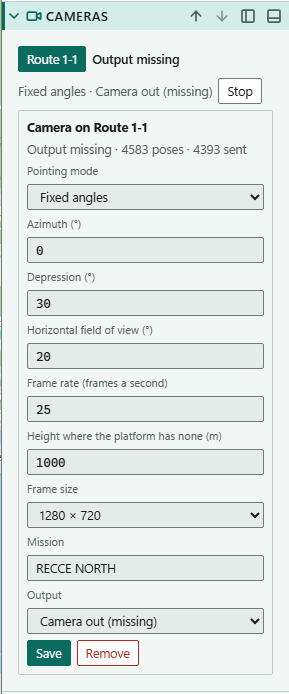

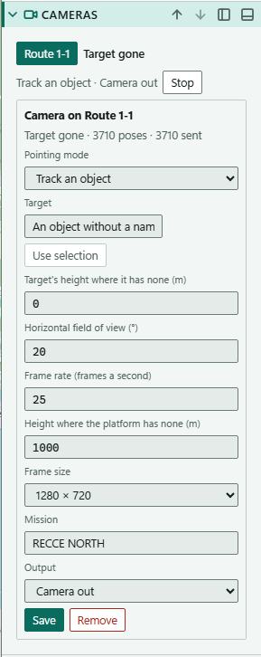

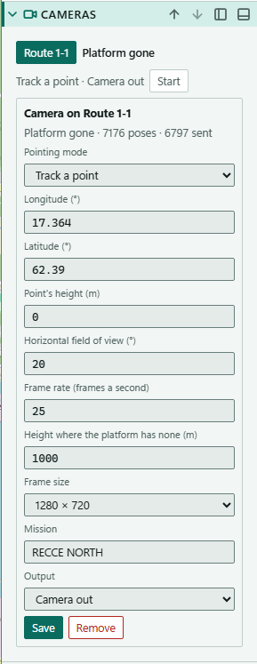

## When it does not work

| What you see | Why, and what to do |
|---|---|
| *No destination* | The output link has no address or port. Fill in both in Settings, under FMV, and save the link (step 6) |
| *Waiting for a pose* in the Monitor | The link has had no pose lately: no camera that sends to it runs. Start the camera |
| *No encoder installed*, and in the Monitor *no converter: tools\ffmpeg\ffmpeg.exe is not there* | The encoder is not where emcc looks. Put `ffmpeg.exe` back into `tools/ffmpeg`, then **save the output link again**: change a value in the form, for example the bit rate. The camera does not start sending again by itself |
| The ground is grey, and the Monitor counts *no imagery* | No imagery set covers where the camera looks, or the camera has not been stopped and started since you put the set in. Check the corners in `imagery.json` and that the set is in the folder that **Imagery folder** names |
| The Monitor says *imagery set ... refused* | The set has no `source` or no `licence`, a tile of the wrong size or a file that is not a picture. The message says which. Correct the file, stop the camera, wait, and start it |
| The ground is flat | No DTED cell covers the camera. Put the cell into `settings/terrain`, and stop and start the camera |
| The camera's state is **Platform gone** | The track was deleted, or left Simulation. The camera stopped by itself. Make a new camera on a new track with **New camera**: a camera cannot be moved to another track |
| The camera's state is **Target gone**, and the mode is **Track an object** | The target was deleted. The camera keeps its last angles. Select another symbol, choose **Use selection**, and **Save**. **Save** does not work in another mode until the target is replaced, and the form does not say why |
| The camera's output says **(missing)** | The output link was switched off or removed. Switch it on in Settings, under FMV, or choose another output |
| The FMV panel has no stream | The input link does not listen on the port that the output link sends to, or the camera does not send. Check both ports, and the Monitor's FMV row |
| The input link says *Address already in use* in the Monitor | Another program uses the port. Choose another port for both links |
| A camera above the output link's **Highest classification** is not drawn | The track's security label is higher than the limit in the link's group Classification, **Highest classification**. The Monitor says *Above release limit*. Raise the limit |
| The Monitor counts *imagery over cap* | The tiles near the camera hold more than about 256 million pixels, and the tiles beyond are grey. Use tiles of lower resolution, or a set that covers a smaller area |

More in [A simulated camera](04-06-camera.md), [FMV output links, imagery and terrain](05-24-fmv-output.md) and [FMV: full motion video](03-19-fmv.md).

## Things to try

- Set **Frame size** to 640 × 360 and **Frame rate** to 10: the picture is smaller and the computer works less.
- Point the camera at a hill in the height data and fly past it.
- Put a second track on the route and make a camera on it, with another output link on another port.
- Switch the output link off in Settings and on again while the camera runs, and watch the camera's state.
